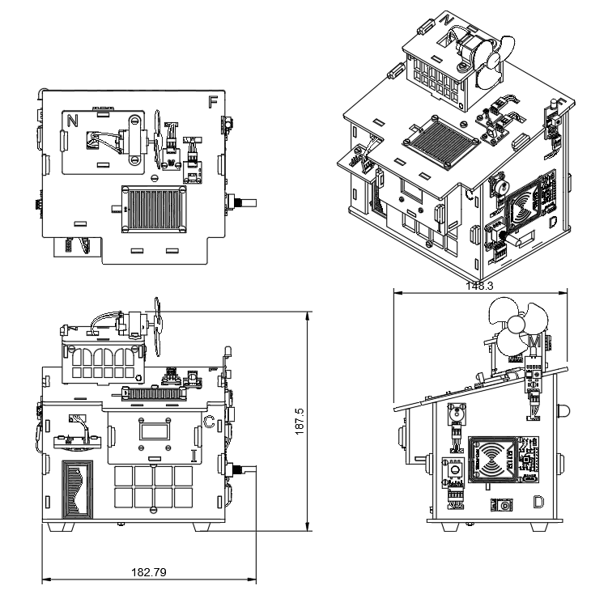

> **Note of Development:**  
> This hardware module is under active development. File and directory structures, naming conventions, and documentation formats may change as the design evolves.  
> 
> - **File Naming:**  
>   - Use capital letters and underscores only.  
>   - Start filenames with `unit_<filename>_v_<version>_<description>.<ext>`.  
>   - Example: `unit_icp10111_barometric_pressure_sensor_v_1_0_0.png`
>   - Schematic: `schematic_v_<version>_<description>.<ext>` (e.g., `schematic_v_1_0_0_icp10111_barometric_pressure_sensor.png`)
>   - Topology: `unit_topology_v_<version>_<description>.<ext>`
>   - Dimensions: `unit_dimension_v_<version>_<description>.<ext>`
> 
> - **README Structure:**  
>   - Hardware overview  
>   - Pinout and connector layout  
>   - Dimensions and topology  
>   - Functional description  
>   - Applications  
>   - References  
> 
> Please refer to the latest commit history for updates and changes.

# Hardware

The **SmartHome Kit (AR4623)** is built around the **UNIT DualMCU ONE** development board, which combines an **ESP32** and an **RP2040**. The sensors and actuators are distributed through a Sensor Shield V5.0, an I²C hub (Qwiic / STEMMA QT), a PCA9685 PWM controller and an MX1508 H-bridge.

## Connection Diagrams

> **Warning:** a wrong connection can damage the modules. Before powering the kit, check that every module is wired as shown in the diagrams below.

### Simplified Shield diagrams

These diagrams summarize the sensors and actuators that connect directly to the Sensor Shield.

<a href="../tools/product-reference/assets/manual/image-275.png">  Simplified Shield diagram (1)</a>
 
 
<a href="../tools/product-reference/assets/manual/image-276.png">  Simplified Shield diagram (2)</a>

### DualMCU ONE, I²C Hub and PCA9685

<a href="../tools/product-reference/assets/manual/image-277.png">  DualMCU ONE, I²C Hub and PCA9685 diagram</a>

### Complete diagram

<a href="../tools/product-reference/assets/manual/image-278.png">  Complete diagram (1)</a>
 
 
<a href="../tools/product-reference/assets/manual/image-279.png">  Complete diagram (2)</a>

### Connection summary

| Module | Connected to | Cable |
|--------|--------------|-------|
| KY-040 Encoder | Sensor Shield | Fixed Dupont 3-way + fixed Dupont 2-way |
| KY-006 Buzzer | Sensor Shield | Fixed Dupont 3-way |
| RC522 RFID reader | Sensor Shield | 7x Dupont F-F |
| KY-026 Flame sensor | Sensor Shield | Fixed Dupont 3-way |
| HC-SR505 PIR | Sensor Shield | 3x Dupont F-F |
| TTP223B Capacitive button | Sensor Shield | Fixed Dupont 3-way |
| FC-37 Rain sensor | Sensor Shield | 2x Dupont F-F (included with the sensor) |
| HX1838 IR receiver | Sensor Shield | Fixed Dupont 3-way |
| KY-018 Photoresistor | Sensor Shield | Fixed Dupont 3-way |
| WS2812 Neopixel (x3) | Sensor Shield | Fixed Dupont 3-way |
| SG90 Servomotor | PCA9685 | Servo connector |
| DC Motor | MX1508 H-bridge | Motor leads |
| MX1508 H-bridge | PCA9685 | 2x fixed Dupont 2-way |
| PCA9685 | Sensor Shield / I²C Hub | Qwiic cable |
| SSD1315 OLED display | I²C Hub | Qwiic to Dupont cable |
| AHT10 Temperature & humidity sensor | I²C Hub | Qwiic to Dupont cable |
| I²C Hub | UNIT DualMCU ONE | Qwiic to Qwiic cable (10 cm) |

> **Notes**
> - Connect the Qwiic to Qwiic cable between the DualMCU ONE and the I²C Hub **before** mounting the Sensor Shield. The Shield is mounted on top of the DualMCU ONE.
> - The I²C Hub ports have no assigned position; the cables can be plugged into any of them.
> - Observe the polarity of the Neopixels: a reversed connection can burn them.
> - Power the servomotor first so it moves to its initial position before mounting the door.
> - The kit is powered with the included 12 V, 2 A jack adapter. The adapter rating does not define the electrical limits of each sensor, the ESP32, the RP2040 or the Shield connectors.

## Dimensions

<a href="./resources/unit_dimensions_smarthome_v_1_1_0.png">  Dimensions</a>

| Parameter | Value |
|-----------|-------|
| Assembled dimensions | 18 x 15 x 19 [cm] |
| Packaging dimensions | 27 x 17 x 15 [cm] |
| Materials | MDF, acrylic and PLA (3D printed parts) |
| Fasteners | Metric slotted cheese head screws |

## Functional Description

The kit is a didactic platform for learning electronics and programming by building a working smart home.

| Subsystem | Components | Function |
|-----------|------------|----------|
| Control | UNIT DualMCU ONE (ESP32 and RP2040) | Runs the firmware and coordinates the app with the modules. |
| Environmental inputs | AHT10, KY-018, FC-37, KY-026, HC-SR505 | Measure temperature, humidity, light, rain, flame and motion. |
| User inputs | KY-040, TTP223B, RC522, HX1838 | Interaction through encoder, touch, RFID and infrared. |
| Outputs | SG90, DC motor, buzzer, three WS2812, OLED | Movement, sound alerts, lighting and display. |
| Expansion and control | Sensor Shield V5.0, I²C Hub, PCA9685, MX1508 | Connection distribution, I²C bus, PWM outputs and motor control. |
| Application | SmartHome app for Android | Shows sensor readings and controls the actuators. |

The kit has two operating modes, selected from the OLED menu with the encoder or the IR remote:

- **App mode ("Programa APP"):** the kit connects to the local WiFi network and the SmartHome app (Android) shows the sensor readings and controls the Neopixels, fan, door and buzzer. If no network is saved, the kit creates the access point `UNIT-WIFI-MANAGER` (portal at `192.168.4.1`) to configure it.
- **Offline mode ("Programa Offline"):** the automation logic runs locally on the RP2040 without WiFi or the app:

| Condition | Automatic action |
|-----------|------------------|
| Temperature above 35 °C or flame sensor active | Turns on the DC motor (fan) |
| Authorized RFID credential | One opens the door (servo), the other closes it |
| Door open and rain detected | Closes the door automatically |
| Unrecognized RFID credential | Shows a random warning message on the display |
| Low ambient light (photoresistor) | Turns on the outdoor Neopixels |
| Capacitive button pressed | Buzzer plays a "Ding Dong" sound |
| PIR detects motion | Turns on a presence indicator Neopixel |

The DualMCU ONE comes with the firmware preloaded. The source code is in [`software/ESP32/Smart_Home_App_ESP_COMV4`](../software/ESP32/Smart_Home_App_ESP_COMV4) and [`software/RP2040/Smart_Home_RP_V1`](../software/RP2040/Smart_Home_RP_V1), and the Android APK is in [`software/App`](../software/App).

## Applications

- Assembly of mechanical parts (MDF, acrylic and 3D printed parts).
- Integration of modular electronics.
- PWM control (servomotor and DC motor).
- I²C communication.
- Reading of digital and analog sensors.
- Control and monitoring from a mobile app.

# References

- [User's guide (Product Reference v1.1.0)](https://unit-electronics-mx.github.io/unit_kit_smarthome/hardware/product-reference/unit_product_reference_v_1_1_0_kit_smarthome.pdf)
- [Product Wiki](https://wiki.uelectronics.com/wiki/unit-smart-home)
- [GitHub repository](https://github.com/UNIT-Electronics-MX/unit_kit_smarthome)
- [Android app (APK)](https://github.com/UNIT-Electronics-MX/unit_kit_smarthome/tree/main/software/App)
- [Arduino IDE](https://docs.arduino.cc/software/ide/)
- [Thonny](https://thonny.org/)
- [Visual Studio Code](https://code.visualstudio.com/)
